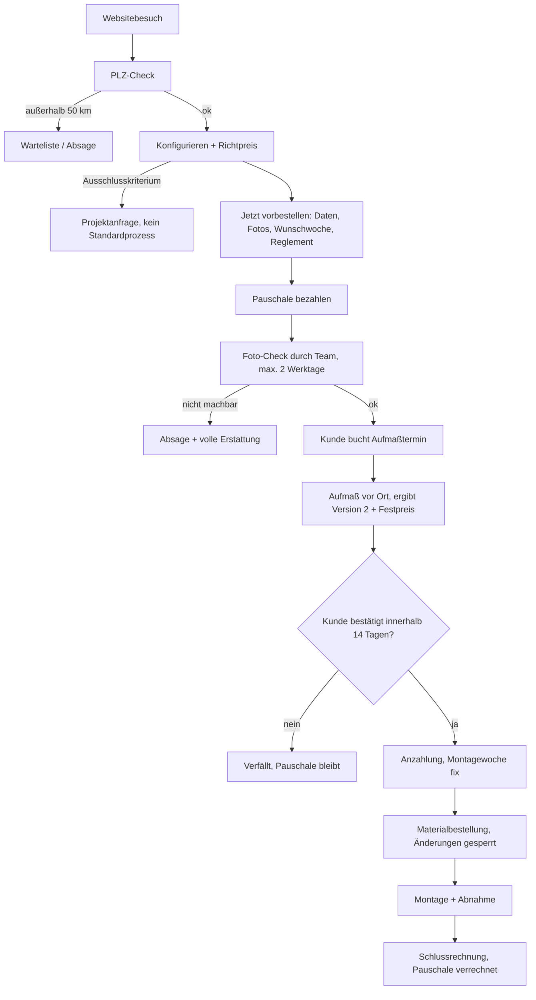

# Prozess: Vom Websitebesuch bis zur fertigen Terrasse

> **Status: Entwurf, in Abstimmung.** Wird gemeinsam überarbeitet, bis er passt. Erst danach leiten wir daraus die Software ab.
> Alle Beträge und Fristen sind Vorschläge und als `[Vorschlag]` markiert.

## Ziele

1. **20–30 Vorbestellungen pro Saison**, fest durchterminiert.
2. **Kein unnötiger Aufwand.** Jeder Arbeitsschritt des Teams ist entweder bezahlt oder führt mit hoher Wahrscheinlichkeit zum Auftrag.
3. **Ein Reglement, das immer greift**: klar, schriftlich, für Kunde und Team gleich.

## Grundprinzipien

| Prinzip | Bedeutung |
|---|---|
| **Der Konfigurator ist das Sortiment** | Was der Konfigurator nicht abbildet, wird nicht im Standardprozess verkauft. Es gibt keine Sonderplanung am Gartenzaun. |
| **Filtern vor Fahren** | Ungeeignete Fälle werden online aussortiert (PLZ, Ausschlusskriterien, Foto-Check). Erst danach fährt jemand raus. |
| **Bündeln statt Einzeltermine** | Es gibt feste Aufmaßtage nach Region, Sammelbestellung beim Material und Montagewochen. |
| **Prüfen statt Planen** | Beim Aufmaß wird die Kundenkonfiguration **geprüft und korrigiert**. Neu geplant wird dort nicht. |
| **Selbstbedienung zuerst** | Der Kunde ändert selbst online, was er ändern darf. Das kostet das Team nichts. |
| **Jede Stufe hat einen Preis oder eine Frist** | Pauschale, Angebotsgültigkeit, Revisionsgrenze. So bleibt nichts in der Schwebe. |

## Saisonmodell `[Vorschlag]`

Vorbestellungen laufen in einer **Saison mit festem Kontingent**:

| Phase | Zeitraum (Beispiel Saison 2027) | Was passiert |
|---|---|---|
| Vorbestellphase | Dez 2026 – Feb 2027 | Konfigurieren und vorbestellen, Kontingent z. B. 25 Plätze |
| Aufmaßwellen | Jan – Mrz 2027 | Feste Aufmaßtage, z. B. dienstags im Gebiet Nord und donnerstags im Gebiet Süd |
| Materialbestellung | laufend, gebündelt pro Montagewelle | Sammelbestellung bringt bessere Preise und planbare Lieferung |
| Montage | Apr – Jul 2027 | z. B. 2 Terrassen pro Woche, ergibt rund 13 Wochen für 25 Terrassen |

Auf der Website ist die Verfügbarkeit sichtbar, zum Beispiel: *„Saison 2027: noch 9 von 25 Plätzen frei – nächste freie Montagewoche: KW 19"*. Das schafft Planbarkeit für das Team und Verbindlichkeit beim Kunden.

## Der Ablauf Schritt für Schritt

### Übersicht



### Schritt 1: Websitebesuch

Der Kunde landet über Google, Instagram oder eine Empfehlung auf **modul-garten.de/terrasse**. Dort findet er:
- Bilder und die 3 Varianten im Vergleich
- **„Ab 250 €/m² inkl. …"** (was genau enthalten ist, ist noch offen)
- „So läuft's ab" in 5 Schritten, also dieser Prozess in Kurzform
- den Saisonzähler mit den freien Plätzen
- den Button **„Terrasse konfigurieren"**

### Schritt 2: PLZ-Check (erste Frage im Konfigurator)

*„Wo soll Ihre Terrasse entstehen?"* Der Kunde gibt die PLZ ein.
- **Innerhalb von 50 km:** weiter zum Konfigurator. Die Region (Nord/Süd) wird gleich mitbestimmt, sie entscheidet später über den Aufmaßtag.
- **Außerhalb:** freundliche Absage mit Angebot zur Warteliste bzw. zum Newsletter. Der Kontakt bleibt erhalten, das Team hat keinen Aufwand.

### Schritt 3: Konfigurieren

Die Schritte im Konfigurator mit Vorschlag zum Inhalt:

1. **Variante** (3 zur Auswahl), mit Bild und den Unterschieden
2. **Form und Maße**: Rechteck oder L-Form, Maße im Plattenraster. Die 3D-Ansicht aktualisiert sich live, eine 2D-Draufsicht mit Maßketten hilft beim Eingeben.
3. **Situation vor Ort** (entscheidend für den Unterbau):
   - Was liegt dort heute? Rasen/Erde, alte Platten, Beton, Holzterrasse
   - Anschluss an das Haus? Wenn ja: Höhe der Türschwelle über dem heutigen Boden
   - Ist das Gelände eben oder geneigt?
   - Zugang für Material: Wie breit ist der schmalste Durchgang?
4. **Extras**, z. B. Entsorgung des alten Belags, Randeinfassung
5. **Zusammenfassung**: 3D-Bild, Maße, Fläche, **Richtpreis**, Hinweis „vorbehaltlich Aufmaß"

**Ausschlusskriterien** `[Vorschlag]`: Der Konfigurator erkennt sie und leitet automatisch zur Projektanfrage um, eine Vorbestellung ist dann nicht möglich:
- Fläche über 80 m² oder unter 8 m²
- Höhenunterschied über 30 cm (Stufen, Stützmauer)
- Dachterrasse oder Balkon
- mehr als 3 Wohneinheiten bzw. Objekte (gilt für Gewerbe)

Der Kunde kann jederzeit **„Konfiguration speichern"**. Er bekommt dann einen Link per E-Mail und kann später weitermachen. Das ist ein Lead für spätere Erinnerungen.

### Schritt 4: „Jetzt vorbestellen"

Der Kunde klickt in der Zusammenfassung auf **„Jetzt vorbestellen"**. Es folgt ein Formular auf einer Seite:

1. **Kontakt und Baustelle:** Name, E-Mail, Telefon, Adresse der Baustelle. Wahl *Privat / Gewerbe*; bei Gewerbe kommen Firma und USt-ID dazu, die Preise werden netto angezeigt.
2. **Fotos (Pflicht):** 3–4 Fotos nach Vorlage: Gesamtfläche, Hausanschluss bzw. Türschwelle, Zugang, Untergrund im Detail. Der Konfigurator zeigt Beispielbilder dazu.
3. **Wunsch-Montagewoche:** Auswahl aus den freien Wochen. Die Woche ist **vorläufig reserviert**.
4. **Reglement bestätigen:** Die Kernregeln stehen in Kurzform da (siehe Reglement unten) und müssen abgehakt werden:
   - ☐ Mir ist klar, dass der Preis ein Richtpreis ist und der Festpreis nach dem Aufmaß feststeht.
   - ☐ Die Vorbestellpauschale von 199 € wird bei Auftrag voll verrechnet. Bei Nichtbeauftragung nach erfolgtem Aufmaß bleibt sie als Aufwandsentschädigung.
   - ☐ Ich verlange ausdrücklich, dass das Aufmaß vor Ablauf der Widerrufsfrist erfolgen kann. (Rechtlich prüfen lassen!)
   - ☐ AGB und Datenschutz
5. **Weiter zur Zahlung:** Es folgt die WooCommerce-Kasse mit dem Produkt „Vorbestellpauschale Terrasse", verknüpft mit der Konfigurationsnummer. Zahlarten: PayPal, Karte, Sofort oder Überweisung.
   - Bei Überweisung hält die Reservierung **3 Werktage**. Danach wird der Platz wieder freigegeben.

**Bestätigungsseite und E-Mail:** *„Ihre Vorbestellung T-2027-014 ist eingegangen."* Dazu kommt ein **Statuslink**, unter dem der Kunde jederzeit sieht, wo er steht:

```
✔ Konfiguriert   ✔ Vorbestellt   ○ Foto-Check   ○ Aufmaß   ○ Festpreis   ○ Montage
```

### Schritt 5: Foto-Check durch das Team (innerhalb von 2 Werktagen)

Das Team erhält eine Benachrichtigung und prüft im Team-Bereich in etwa **10–15 Minuten**: Fotos, Angaben und Plausibilität.
- **Passt:** Status wird „Geprüft". Der Kunde erhält eine E-Mail: *„Bitte buchen Sie Ihren Aufmaßtermin."*
- **Rückfrage:** Ein Foto fehlt oder die Schwelle ist unklar. Der Kunde lädt nach, das geht über den Statuslink.
- **Nicht machbar:** Absage mit **voller Erstattung** der Pauschale. Bis hierhin ist kaum Aufwand entstanden, und der Kunde bleibt fair behandelt.

### Schritt 6: Aufmaßtermin buchen

Über den Statuslink sieht der Kunde nur Termine an den **Aufmaßtagen seiner Region**, z. B. *Di, 19.01., 10:00–10:45*.
- Er bucht selbst. Das erspart Telefonate und E-Mails.
- Am Vortag kommt eine Erinnerung: *„Bitte seien Sie anwesend, die Fläche muss zugänglich sein."*
- **Absage:** bis 48 h vorher kostenlos umbuchbar, einmal.

### Schritt 7: Aufmaß vor Ort (max. 45 Minuten)

Der Techniker öffnet die Konfiguration auf dem Tablet im **Team-Modus** und arbeitet eine **Checkliste** ab:
1. Maße nachmessen und korrigieren
2. Höhe der Türschwelle und Gefälle prüfen
3. Untergrund prüfen (Spaten, Sondierung)
4. Zugang und Lagerfläche für das Material klären
5. Hindernisse erfassen: Lichtschacht, Fallrohr, Leitungen

Das Ergebnis ist **Version 2** der Konfiguration. Der Preis berechnet sich sofort neu, **der Festpreis steht also noch vor Ort fest**. Ein separates Angebot muss nicht erstellt werden.

Gegen das Ausufern:
- **Änderungen nur innerhalb des Baukastens.** Variante, Maße und Extras lassen sich direkt im Tablet ändern.
- **Ideen-Parkplatz:** Wünsche außerhalb des Baukastens (Pflanzbeet, Beleuchtung, Stufe) werden notiert, aber **nicht vor Ort geplant**. Satz für den Techniker: *„Das nehme ich gern auf. Das ist nicht Teil der Standardterrasse, dazu melden wir uns separat."*
- **Gemessene Werte werden gesperrt** (Maße, Höhen, Untergrund). Der Kunde kann danach online nur noch ändern, was ihm frei steht: Variante wechseln, Extras, Fläche **innerhalb** der gemessenen Maße verkleinern.

### Schritt 8: Festpreis und Auftragsbestätigung

Noch am Tag des Aufmaßes erhält der Kunde Version 2 mit Festpreis über den Statuslink.
- Das Angebot ist **14 Tage gültig**.
- Selbstbedienungs-Änderungen im erlaubten Rahmen kann er online selbst machen. Der Preis aktualisiert sich, für das Team entsteht kein Aufwand.
- **Eine Revision durch das Team ist inklusive**, etwa wenn ein gesperrter Wert neu bewertet werden muss. Jede weitere kostet 99 € `[Vorschlag]`.
- **„Verbindlich beauftragen"** löst die Anzahlung von **30 %** aus. Danach ist die Montagewoche **fest**.
- Ohne Bestätigung innerhalb von 14 Tagen verfällt das Angebot. Die Woche wird freigegeben, die Pauschale bleibt.

### Schritt 9: Materialbestellung und Vorbereitung

- Das Material wird gebündelt pro Montagewelle bestellt.
- **Mit der Materialbestellung sind Änderungen gesperrt.** Der Kunde wird darauf vorher per E-Mail hingewiesen.
- 7 Tage vor der Montage erhält er eine E-Mail mit seinen Mitwirkungspflichten: Fläche geräumt, Zugang frei, Strom und Wasser verfügbar, Parkmöglichkeit für den Transporter.

### Schritt 10: Montage und Abnahme

- Montage in der vereinbarten Woche. Ein konkreter Tag wird 7 Tage vorher genannt.
- **Wetter:** Wir verschieben, der Kunde wird sofort informiert und bekommt den nächsten freien Slot, ohne Kosten.
- Am Ende steht ein **Abnahmeprotokoll** auf dem Tablet, mit Fotos und Unterschrift.

### Schritt 11: Abschluss

- Schlussrechnung = Festpreis − Anzahlung − Pauschale.
- Nach 7 Tagen kommt eine Bitte um eine Bewertung und Freigabe von Referenzfotos.
- Nach einem Jahr folgt eine Pflegetipp-Mail mit Hinweis auf Pergola und andere Produkte (Zusatzgeschäft).

## Das Reglement (Entwurf)

Gilt immer, für jeden Kunden. Im Zweifel gilt das Reglement, nicht die Situation vor Ort. Die kundenseitige Fassung wird Teil der AGB bzw. Vorbestellbedingungen.

| Nr. | Regel |
|---|---|
| **R1** | Verkauft wird nur, was der Konfigurator abbildet. Alles andere ist eine **Projektanfrage** außerhalb des Vorbestellprozesses. |
| **R2** | Einzugsgebiet: 50 km. Ausnahmen nur für Gewerbe ab 50 m² gegen Anfahrtszuschlag. `[Vorschlag]` |
| **R3** | Vor jedem Aufmaß stehen eine **bezahlte Vorbestellpauschale** (199 €) und ein bestandener Foto-Check. Ohne beides fährt niemand raus. |
| **R4** | Lehnen **wir** nach dem Foto-Check ab, wird die Pauschale voll erstattet. Nach erfolgtem Aufmaß wird sie bei Auftrag verrechnet und bleibt ansonsten bei uns. |
| **R5** | Aufmaß maximal 45 Minuten, nach Checkliste. **Beim Aufmaß wird geprüft, nicht neu geplant.** |
| **R6** | Wünsche außerhalb des Baukastens kommen auf den Ideen-Parkplatz und werden nicht vor Ort geplant. |
| **R7** | Gemessene Werte sind nach dem Aufmaß gesperrt. Was nicht gesperrt ist, ändert der Kunde selbst online. |
| **R8** | Eine Revision durch das Team ist inklusive, jede weitere kostet 99 €. |
| **R9** | Ein Festpreisangebot gilt 14 Tage. Danach verfällt es und die Montagewoche wird freigegeben. |
| **R10** | Ab Materialbestellung sind keine Änderungen mehr möglich. |
| **R11** | Absage des Aufmaßtermins bis 48 h vorher kostenlos (einmal). Danach oder bei Nichterscheinen kostet ein neuer Termin 99 €. |
| **R12** | Verzögert der Kunde die Montage (Fläche nicht frei, kein Zugang), fällt eine Leerfahrtpauschale an und die Terrasse wird in die nächste freie Woche verschoben. |
| **R13** | Wetterbedingte Verschiebungen trägt der Betrieb ohne Kosten für den Kunden. |
| **R14** | Zahlungsplan: 199 € Pauschale, 30 % Anzahlung bei Beauftragung, Rest nach Abnahme. |
| **R15** | Kommunikation läuft über den Statuslink bzw. das Portal und E-Mail. Telefon nur zur Terminabsprache in Ausnahmefällen. |

## Simulation: sechs Kunden durchgespielt

### Fall 1: Familie Becker, der Idealfall

*Privat, Einfamilienhaus, alte Waschbetonplatten, 32 km entfernt.*

1. **Sa, 12.12., 21:30 Uhr:** Frau Becker sieht eine Instagram-Anzeige, landet auf /terrasse, liest „So läuft's ab". Der Saisonzähler zeigt *„noch 14 von 25 frei"*.
2. Sie gibt die PLZ ein, das liegt im Gebiet. Sie wählt Variante B, ein Rechteck von 5,0 × 4,0 m, Untergrund „alte Platten", Türschwelle 18 cm, Extra „Entsorgung Altbelag". **Richtpreis: 20 m² × 250 € = 5.000 €** plus Entsorgung.
3. Sie speichert und schickt den Link an ihren Mann. Am **So, 13.12.** öffnen beide den Link und sind einverstanden.
4. **„Jetzt vorbestellen":** Sie gibt Daten ein, lädt 4 Handyfotos hoch, wählt KW 17, hakt das Reglement ab und zahlt 199 € per PayPal. Sie erhält die Vorbestellnummer T-2027-011 und den Statuslink.
5. **Di, 15.12.:** Foto-Check in 10 Minuten, alles plausibel. Sie bekommt eine E-Mail zur Terminbuchung.
6. Sie bucht **Di, 19.01., 10:00** (Aufmaßtag Nord).
7. **Aufmaß:** Die Fläche misst 5,05 × 3,95 m. Gemäß Raster wird auf 5,0 × 4,0 bestätigt, die Schwelle passt, der Untergrund ist tragfähig. Nach 35 Minuten ist alles erledigt. Version 2 entspricht Version 1, der **Festpreis entspricht dem Richtpreis**.
8. Am Abend klicken die Beckers auf „Verbindlich beauftragen" und überweisen 30 % Anzahlung. **KW 17 ist fest.**
9. Montage in KW 17, Abnahme, Schlussrechnung. Sie geben eine 5-Sterne-Bewertung.

**Aufwand fürs Team:** 10 min Foto-Check + 35 min Aufmaß (plus Anfahrt, gebündelt mit 3 anderen Terminen an diesem Tag) + Montage. Keine Telefonate, kein separates Angebot.

### Fall 2: Familie Wagner, Maße stimmen nicht

*Privat, 25 m² konfiguriert, Variante C.*

1. Vorbestellung und Foto-Check verlaufen normal. Auf einem Foto erkennt das Team einen **Lichtschacht** und notiert ihn im Team-Bereich für das Aufmaß.
2. **Aufmaß:** Wegen des Lichtschachts sind realistisch nur 22 m² möglich. Die Türschwelle liegt nur 9 cm hoch, die Aufbauhöhe von Variante C passt nicht. Möglich ist nur Variante A.
3. Der Techniker ändert beides im Tablet. Der neue **Festpreis liegt bei 22 m² × 250 €**, also niedriger. Der Kunde sieht die Änderung sofort und versteht den Grund: Die Fotos und Werte sind dokumentiert.
4. Herr Wagner hätte gern doch die Optik von C. Der Techniker sagt: *„C ist bei Ihrer Schwellenhöhe technisch nicht möglich."* Diskussion gibt es keine, denn es gilt die Regel.
5. Er beauftragt nach 4 Tagen.

**Erkenntnis:** Der Konfigurator muss **Höhenabhängigkeiten** kennen (Aufbauhöhe pro Variante gegenüber der Türschwelle) und unpassende Varianten **schon online sperren**. Dann wäre das gar nicht erst passiert. → Anforderung für die Engine.

### Fall 3: Frau Schneider, die Tüftlerin

*Privat, konfiguriert sehr viel und ist unentschlossen.*

1. Sie speichert 6 verschiedene Konfigurationen über 3 Wochen. Das kostet das Team nichts, denn es ist Selbstbedienung.
2. Sie bestellt vor und bezahlt. Der Foto-Check ist ok, das Aufmaß ist gebucht.
3. **Beim Aufmaß:** Sie möchte zusätzlich ein Hochbeet an der Seite, eine LED-Beleuchtung in den Fugen und „vielleicht doch eine runde Ecke".
   - Der Techniker nimmt alles auf den **Ideen-Parkplatz** (R6) und beendet das Aufmaß nach 45 Minuten.
4. Sie erhält Version 2. Online wechselt sie zweimal die Variante und verkleinert die Fläche. Das ist Selbstbedienung und kostet das Team nichts.
5. Dann möchte sie, dass „nochmal jemand schaut", ob die Terrasse 50 cm weiter in den Garten passt. Das betrifft gesperrte Werte, also nutzt sie damit ihre **inklusive Revision** (R8). Das Team prüft anhand der Fotos und des Aufmaßes am Schreibtisch, das gibt Version 3.
6. Weitere Wünsche würden je 99 € kosten. Sie lässt das Angebot **verfallen** (R9).
7. Die Pauschale bleibt (R4), die KW wird automatisch frei und erscheint wieder im Saisonzähler.

**Erkenntnis:** Ohne Reglement hätte dieser Fall leicht 5–8 Stunden gekostet. Mit Reglement sind es rund 1,5 Stunden, bezahlt durch die Pauschale. Der Ideen-Parkplatz liefert außerdem Wissen darüber, **was Kunden sich wünschen**. Das ist Material für künftige Baukasten-Erweiterungen.

### Fall 4: Herr Yilmaz, außerhalb des Baukastens

*Privat, Hanggrundstück, L-Form mit 2 Stufen.*

1. Er konfiguriert eine L-Form und gibt beim Gelände „geneigt, ca. 50 cm Höhenunterschied" an.
2. Der Konfigurator schlägt an, denn das Ausschlusskriterium Höhe ist erreicht. Er sieht: *„Für Ihre Situation ist eine individuelle Planung nötig. Gern nehmen wir Ihre Anfrage auf."* Eine Vorbestellung ist nicht möglich.
3. Seine Projektanfrage landet mit der vollständigen Konfiguration und Fotos in einem eigenen Posteingang.
4. Das Team entscheidet in Ruhe: annehmen (individuelles Angebot, kostenpflichtige Planung) oder höflich absagen.

**Erkenntnis:** Solche Fälle verstopfen den Saisonplan nicht. **Offen:** Wollen wir solche Projekte überhaupt machen? Diese Entscheidung ist bewusst zu treffen.

### Fall 5: Wohnbau Krämer GmbH, Gewerbekunde

*Bauträger mit 3 Reihenhäusern, je 18 m² Terrasse.*

1. Der Kunde wählt „Gewerbe", die Preise erscheinen netto. Er konfiguriert eine Terrasse und legt sie mit **„Für weitere Einheiten übernehmen"** dreimal an.
2. 3 Einheiten sind gerade noch erlaubt. Er bestellt vor, die Pauschale gilt **einmal pro Baustellenadresse**. Bezahlt wird per Rechnung bzw. Überweisung.
3. Ein Aufmaßtermin für alle 3 Einheiten, 60 Minuten.
4. Er beauftragt. Die 3 Montagen liegen **in derselben Woche**, das ist besonders effizient.

**Erkenntnis:**
- Mehrere Einheiten pro Vorbestellung müssen möglich sein.
- Gewerbekunden brauchen Netto-Preise und Zahlung auf Rechnung.
- Gewerbekunden sind für die Planung attraktiv. Ein eigenes Kontingent oder Vorzugsbedingungen? → offen.

### Fall 6: Herr Lange, zu weit weg

*70 km entfernt.*

1. Der PLZ-Check schlägt an: *„Leider liegt Ihr Ort außerhalb unseres Montagegebiets."* Ihm wird die Warteliste angeboten.
2. Er trägt sich ein. Das Team hat 0 Minuten Aufwand. Sammeln sich Wartelisten-Einträge in einer Region, ist das ein Signal für eine spätere Gebietserweiterung.

## Erkenntnisse für die Software

Aus den Simulationen ergeben sich diese Anforderungen:

1. **PLZ-Check** mit Entfernungsberechnung und Regionszuordnung (Nord/Süd)
2. **Regel-Engine**: Ausschlusskriterien, Höhenabhängigkeiten pro Variante, Raster
3. **Konfiguration speichern** mit Link, mehrere Konfigurationen pro Kunde, mehrere Einheiten pro Vorbestellung
4. **Foto-Upload** mit Beispielbildern
5. **Kontingent- und Wochenverwaltung** mit vorläufiger Reservierung, Freigabe nach Frist und öffentlichem Saisonzähler
6. **WooCommerce-Anbindung**: Pauschale als Produkt, Zahlungsbestätigung zurück an die API
7. **Statusportal** für den Kunden (Statuslink): Status, Uploads, Terminbuchung, Version ansehen, Selbstbedienungs-Änderungen, Beauftragen
8. **Team-Bereich**: Eingang, Foto-Check, Aufmaßtage, Tablet-Modus mit Checkliste, Sperren von Werten, Ideen-Parkplatz, Revisionszähler
9. **Versionierung** der Konfiguration (V1 Kunde → V2 Aufmaß → V3 Revision)
10. **Automatische E-Mails** bei jedem Statuswechsel, mit Erinnerungen und Fristen
11. **Privat/Gewerbe**: brutto/netto, Firmendaten, Zahlung auf Rechnung

Das ist bewusst **viel**. Für das MVP schneiden wir es so, dass der Prozess von Anfang an gilt, auch wenn Teile davon anfangs manuell laufen. Ein Beispiel: Aufmaßtermine per Buchungstool statt eigener Lösung.

## Offene Entscheidungen

- [ ] Höhe der Vorbestellpauschale (199 €?) und ob sie nach Fläche gestaffelt wird
- [ ] Anzahlung 30 %, oder ein anderer Zahlungsplan?
- [ ] Ausschlusskriterien und Grenzwerte (Fläche, Höhe, Einheiten)
- [ ] Machen wir Projektanfragen außerhalb des Baukastens überhaupt?
- [ ] Saisonmodell mit festem Kontingent, oder ganzjährig rollierend?
- [ ] Montagekapazität pro Woche
- [ ] Regionen für die Aufmaßtage festlegen
- [ ] Selbst-Aufmaß als Option für einfache Fälle (spart Fahrten, birgt aber mehr Risiko)?
- [ ] Rechtliche Prüfung: Widerruf, Pauschale, AGB, Verbraucherbauvertrag
